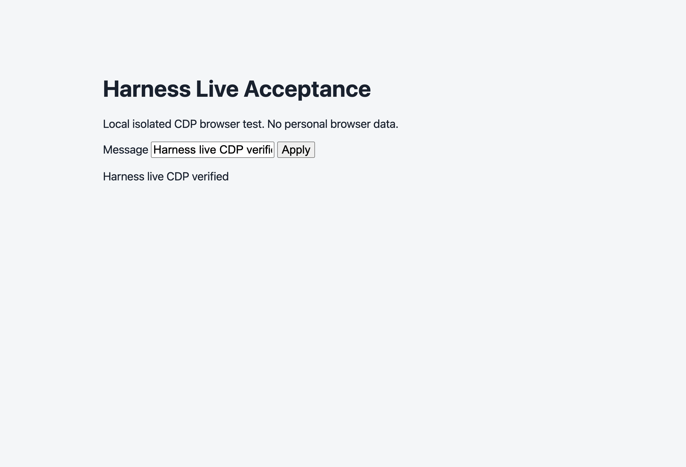

# 第三题 Harness：实现与验收报告

CLI 客户端、本机常驻服务和两款独立插件已经完成。2026-11-18 的最终离线回归为 **337 passed**；真实 OpenRouter 验收、真实有界面 Chrome、CLI 模型任务和重启持久化也已完成。交付时服务仍运行在 `http://127.0.0.1:8765`，两插件长期 enabled，状态为 ready、非 busy。

## 现在使用

```bash
cd '<PROJECT_DIR>'
source .venv/bin/activate
harness daemon status
harness run '必须使用工具计算 (35 × 7 - 128) ÷ (12 + 8)，不要心算。' --plugin arithmetic
```

源代码在项目的 `harness-project/`，运行配置和数据在 `~/.harness/`。OpenRouter key 仅位于私有运行目录，文件权限 0600；CLI 只使用独立本地 token。没有提交 Git、发布到公网、安装 LaunchAgent，或操作日常浏览器 profile。

## 两款插件不是宿主内置业务

宿主 `src/harness/` 中没有 `arithmetic_*`、`ArithmeticEngine`、`browser-safety` 或 `BrowserService` 业务分支。两个插件分别由独立 `plugin.yaml + __init__.py` 通过 `register(ctx)` 增加能力；安装复制到私有托管目录，记录版本/源路径/内容指纹，默认禁用且 add 不执行代码。显式启用/单次选择才在宿主内加载协议能力。

四则插件提供 add/subtract/multiply/divide/parse 五工具。parse 是有界递归下降 + Decimal，不是 eval。实际 CLI 模型 run `run_ecfcf6a71f55474aa8ed1d5a22c53f6a` 的 trace 明确出现 `arithmetic_parse` 的 intent、started、result；expression 原样为 `(35 × 7 - 128) ÷ (12 + 8)`，工具结果 `"5.85"`，随后模型才给出最终 5.85。错误表达式 `(35 × 7 -) ÷ (12 + 8)` 返回 `syntax_error`、零基位置 9；单元测试另覆盖除零、非法 token、精度/深度/超长和代码注入拒绝。

浏览器插件提供 open/navigate/eval/extract/close/status/release 七工具。真实混合 run `run_65ca2749d784492ab50bcb5544b8844c` 在 6 个模型回合中实际执行：

```text
arithmetic_parse
browser_open
browser_navigate
browser_eval
browser_extract
browser_status
→ 最终报告：算术 5.85，页面 Harness live CDP verified
```

open 与 arithmetic_parse 同批声明，后续模型根据真实结果继续操作。navigate 使用同一 target，不新建页；eval 编译再执行固定验收 JS，填写本地表单并点击 Apply；extract 返回页面结果文本。独立 CDP 核验获得真实窗口 `windowState: normal`、1200×905 窗口；没有 headless 或关闭 Chrome sandbox 的参数。页面截图如下：



同会话后续 run `run_63e156ec1e584553b881c870d9ae15b0` 实际调用 close + release，close 已确认，`unreclaimed: []`。确定性真实 Chrome 预检还验证了默认 3 页名额、第 4 页被拒、跨会话拒绝、两次打开复用同一个 browser instance、编译语法错误、确认关闭退名额和 release 后停止状态；close false/异常/缺字段/快照缺页不退名额由 CDP stub 回归覆盖，未伪造真实 Chrome 的 false 响应。

测试页面已清理，单例 Chrome 的启动 about:blank 作为 foreign 页保留，供下次复用；release 不关闭其它会话/foreign 页或整个浏览器。

## 已完成的服务验收

使用官方 OpenAI Python SDK 对本地 `/v1/chat/completions` 验证了非流式 `.create`、raw response headers、标准 SSE delta/finish_reason/usage/[DONE]。工具 trace 使用独立原生 events；服务先返回流式接受首包，最终文本在工具循环结束后输出，不宣称这是上游逐 token 流。空插件集合成功完成文本请求。

真实 CLI 的直接工具路径和 `harness run` 模型路径分别通过。实际停用 arithmetic 后，默认工具列表不再出现算术工具；一次显式选择仍可执行，配置 bytes 不变，下次默认仍保持停用，再显式恢复长期启用。SDK/原生任务的一次插件选择也没有改变长期配置。

daemon 的实际 start、重复 start 复用、status、clean stop 和 restart 已验证。最终实例为 `0abd19ed4a6b4d90ac7d4ead49065fbb`，PID 15039、config revision 8；重启后 5 条已记录 native run 的结果、聊天历史及插件启用状态逐条保留。锁和认证 instance/PID 共同核验，未按端口或模糊进程名误杀其它程序。

337 项离线测试还覆盖严格消息配对、同批多调用、跨回合复用 call ID、错误 observation、增量持久化、未知副作用封锁会话、幂等冲突、busy、cancel/软 timeout 保槽、Origin/弱 token 拒绝、配置 revision/坏值、窄 handler 签名、async 标记、指纹防篡改和 provider 错误分类。剩余 1 个 warning 是 Starlette 对 TestClient/httpx 的弃用提示，不是测试失败。真实事故/断电/GIL 永久挂起没有通过破坏本机来“实测”；对应恢复逻辑和保守状态只作确定性测试结论。

## 模型、费用与本次遇到的问题

初选 `openai/gpt-4.1-mini` 的 Chat 请求得到 OpenRouter 403。只读 key 认证检查为 200；同 route 的一个 8-token 诊断明确返回 **This model is not available in your region**，不是 key 无效。没有自动换模型，随后按用户允许的型号范围人工配置 `qwen/qwen3-235b-a22b-2507`，停服重启后验收成功；源码默认 route 同步改为这个明确 ID，仍禁止自动 fallback 和用户排除的模型系列。

成功生成的 6 条 chat run 合计 15 个实际模型请求，累计收到的 **usage.cost 为约 0.00347565 USD**。其中 SDK 两条无工具任务各 1 回合，独立算式 2 回合，混合任务 6 回合，清理任务 3 回合，最终 CLI 算式 2 回合。该数值来自上游 usage，而不是模型页报价估算；地区失败请求没有 usage，不能把缺失记录伪记为零成本或断言它们计费。

第一次测试 Chrome 在受限本地执行环境中发生原生 SIGTRAP 崩溃。用户提供的 PID 71654 报告与专用日志的 sandbox initialization failed 相符。独立核实 PID、所有专用 profile 子进程和 CDP 均已消失后，只归档自己的 stale 锁，在允许原生启动/专用 PID 核验的权限下重新运行成功；没有禁用 Chrome 自身 sandbox，也没有删账本假退名额。最后一个 CLI 检查曾因读取配置顺带 chmod 目录被策略拒绝；已经改为纯读取，新增回归并只补跑无模型阶段，未重复生成已通过任务。

## MVP 的真实边界

这是 full-trust Python 插件宿主，不是恶意插件沙箱。支持明确的 Hermes 风格 standalone 子集，不承诺完整 ABI、hook、override、自动依赖安装、远程复杂 schema 或宿主模块替换。任意 register/handler 要快速且遵守协议；Python 线程不能强杀，卡住时保留槽和 draining，不假装完成。首版没有 force-stop CLI、LaunchAgent 安装或日志轮转/follow；这些没有伪列为已通过功能。

浏览器所有权只约束工具分发。任意 page JS 可产生网络、导航和弹窗副作用；可识别 opener 链的弹窗记账，noopener/opener-less 页面保守视为 foreign。名额不是 Chrome 页面物理硬上限，页面消失/浏览器退出也不能替代 success:true 的确认关闭。extract 只读可见 body.innerText，不承诺跨域 iframe 全文或截图 OCR。

本地 Chat 是受控 Harness 兼容子集，不是完整 OpenAI 透明代理。仅接受发布 alias、文本消息、n=1、受限输出和服务批准工具；模型超时/断连可能仍产生上游计费，幂等 key 不代表外部副作用 exactly-once。completed 历史可查询/续接；未知或未配对会话保守拒绝续写，重启不自动重播任何工具。

## 交付物与复现

[源码与全部测试压缩包](https://github.com/jorschac/local-agent-harness) 包含宿主、两插件、uv.lock、README、可重复验收脚本及本文/证据副本；不含 `.venv`、私密运行状态或 API key。[使用与开发说明](../README.md) 说明命令和插件协议。[完整机器可读验收证据](./验收证据.json) 包含实际 run/events/cost 和本次初始失败事实。

```bash
bash scripts/bootstrap.sh
.venv/bin/python -m pytest -q
.venv/bin/python scripts/verify_live.py --confirm-model-cost --output-dir /tmp/harness-live-check
```

第二条命令会产生新的真实模型请求，须服务运行；使用临时 loopback 测试页而非个人账户。验收脚本还支持 `--resume-from`，在已验证模型/浏览器阶段后只补跑 CLI/认证/选择检查，不自动重发已完成模型任务。

## 2026-11-18 13:45：本地构建修正与 DeepSeek 补测

用户本地验收反馈后复现了 `ModuleNotFoundError: harness`：可编辑安装的 `.pth` 带 macOS `UF_HIDDEN`，当前 Python 明确跳过它。标记清除后会再次出现，故最终不采用清标记或 PYTHONPATH 规避，而是 **普通 wheel（非 editable）安装**。新增 `scripts/bootstrap.sh` 和项目内 `./harness`，无需激活虚拟环境；用新入口真实 start/stop/status、直接算式工具均通过。最终回归为 **339 passed**，仍只有同一 Starlette 弃用 warning。修改宿主源码须重新构建并重启服务。

**本文之前的裸 uv sync/uv run 示例请用以下命令替代，不要重新切回 editable：**

```bash
cd '<PROJECT_DIR>'
bash scripts/bootstrap.sh
./harness daemon start
./harness run '用工具计算 (35 × 7 - 128) ÷ (12 + 8)' --plugin arithmetic
.venv/bin/python -m pytest -q
```

最终服务按 wheel 包重启，instance `ae079a752d8545b999701d04635aa9f6`、PID 60780、ready:true、busy:false、revision仍8。常驻配置仍是Qwen，没有擅自切换。

另经当前本机网络、原有 OpenRouter key 和宿主现有 provider 参数，对 `deepseek/deepseek-v4.1-flash-1017` 做了隔离宿主 loop + arithmetic 插件检查：实际调用 arithmetic_parse、两回合完成、结果 5.85，收到 cost=$0.000121484，未修改长期配置。此结论是当前出口/账号/路由可用，不保证所有中国大陆网络均能连接 OpenRouter，也未宣称 DeepSeek 下完整浏览器回归已经重跑。OpenRouter 目录中另有 `deepseek/deepseek-v4.1-flash`，推荐明确的1017快照；官方直连需不同平台的 API key。

修正版本：[源码包 v1.1](https://github.com/jorschac/local-agent-harness)。详细构建与模型切换步骤已更新到主 README；压缩包附 DeepSeek 最小验证 JSON，不包含 key。
